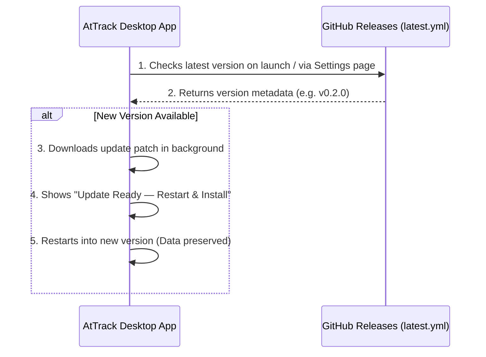

# AtTrack Electron Development & Auto-Update Guide

This document explains how code changes reflect in **AtTrack**, how local development works without re-installing, how data persistence is guaranteed, and how auto-updates work for packaged users.

---

## Table of Contents
1. [Overview & Quick Reference](#1-overview--quick-reference)
2. [Development Workflows (No Re-Installation Required)](#2-development-workflows-no-re-installation-required)
3. [How Data Persistence Works (Why Reinstalls Don't Lose Data)](#3-how-data-persistence-works-why-reinstalls-dont-lose-data)
4. [How Auto-Updates Work for Distributed Users](#4-how-auto-updates-work-for-distributed-users)
5. [Building & Releasing New Versions](#5-building--releasing-new-versions)

---

## 1. Overview & Quick Reference

| Command | Purpose | Hot Reload? | Generates `.exe`? |
| :--- | :--- | :---: | :---: |
| `npm run dev` | Fast web browser development | ✅ Yes | ❌ No |
| `npm run electron:dev` | Test Next.js + Electron standalone integration locally | ❌ No | ❌ No |
| `npm run build:electron` | Package production installer setup executable | ❌ No | ✅ Yes (`release/`) |

---

## 2. Development Workflows (No Re-Installation Required)

You **do NOT need to reinstall the `.exe`** when developing or adding features!

### Option A: Web Browser Development (Fastest DX)
1. Run:
   ```bash
   npm run dev
   ```
2. Open `http://localhost:3000` in your browser.
3. **What happens**: Any edits to React components, tailwind CSS, server actions, or SQLite queries update instantly with Hot Module Replacement (HMR).

### Option B: Local Electron Window Testing
1. Run:
   ```bash
   npm run electron:dev
   ```
2. **What happens**: Next.js builds locally into `.next/standalone`, spawns the local node server, and opens the native **AtTrack Electron desktop window**.

---

## 3. How Data Persistence Works (Why Reinstalls Don't Lose Data)

When you uninstall, reinstall, or update the AtTrack desktop application, **your jobs, contacts, resumes, settings, and AI provider API keys remain 100% safe and intact**.

### Where is user data stored?
- **SQLite Database**: Stored in `%APPDATA%\AtTrack\attrack.db` (Windows) or your custom chosen data directory.
- **Uploaded Files / Resumes**: Stored in `%APPDATA%\AtTrack\storage\`.
- **Encrypted Keys & Settings**: Stored in `%APPDATA%\AtTrack\settings.json`.

Because user data is stored in OS-level user data directories, deleting or updating the application files inside `Program Files` or `release/win-unpacked` **never deletes or modifies your database**.

---

## 4. How Auto-Updates Work for Distributed Users

Re-downloading and reinstalling `.exe` files manually is frustrating. AtTrack uses **`electron-updater`** to automate updates seamlessly.



### How to trigger auto-updates in the UI:
1. Open **Settings** $\to$ **Application Updates**.
2. Click **Check for Updates**.
3. If a new version exists on GitHub Releases:
   - The progress bar shows the background download percentage.
   - When complete, click **Restart & Install**.

---

## 5. Building & Releasing New Versions

### Step 1: Update Version in `package.json`
When publishing a new release, bump the version number:
```json
{
  "name": "attrack",
  "version": "0.2.0"
}
```

### Step 2: Build Executable
Run the build script:
```bash
npm run build:electron
```
This produces:
- `release/AtTrack-Setup-0.2.0.exe` (Windows NSIS Installer)
- `release/latest.yml` (Auto-update metadata manifest)

### Step 3: Publish Release on GitHub
1. Go to your GitHub repository: `https://github.com/kaiumallimon/aven`
2. Create a new Release tagged `v0.2.0`.
3. Upload `AtTrack-Setup-0.2.0.exe` and `latest.yml` to the Release assets.
4. Installed desktop apps will now automatically detect `v0.2.0` and prompt users to update with a single click!
