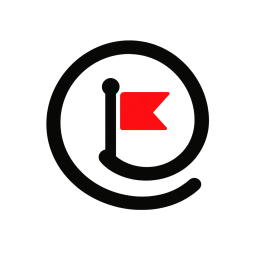

<div align="center">

<picture>
  <source media="(prefers-color-scheme: dark)" srcset="public/icon-256-dark.svg">
  
</picture>

# BetterJob

### *A better way to reach your next job.*

**The private, local-first career workspace and job application tracker.**  
Manage your job search, build tailor-fit resumes, prep for interviews, track networking CRM contacts, and leverage AI career co-pilots — 100% on your own machine.

[-000000?style=flat-square&logo=next.js)](https://nextjs.org/)
[](https://react.dev/)
[](https://www.typescriptlang.org/)
[](https://nodejs.org/api/sqlite.html)
[](https://tailwindcss.com/)
[](https://www.electronjs.org/)
[](https://developer.chrome.com/docs/extensions/mv3/)
[](LICENSE)

[Features](#-product-features) • [Why BetterJob?](#-why-betterjob) • [Getting Started](#-getting-started) • [Architecture](#-architecture) • [Chrome Extension](#-companion-chrome-extension) • [Desktop App](#-desktop-app)

---

</div>

## 🌟 Why BetterJob?

Traditional job hunting tools (Huntr, Teal, Notion templates) force trade-offs: your private resumes, salary notes, and career trajectory live in someone else's cloud behind expensive monthly AI subscriptions.

**BetterJob reimagines the job search as a modern, private desktop operating system:**

- 🛡️ **100% Local-First Privacy**: Your entire database, uploaded resumes, salary goals, and application notes live in a local SQLite database (`node:sqlite`) on your disk. No remote database, no tracking cookies, and no accounts.
- 🔑 **Bring-Your-Own-Key (BYOK) AI**: Zero middleman markup. Plug in your own Google Gemini, Anthropic Claude, OpenAI, or OpenRouter keys.
- ⚡ **Instant Capture**: Save postings from LinkedIn, Indeed, Greenhouse, Lever, and company career portals with a single click via the companion Chrome extension.
- 🎯 **Unified Career Pipeline**: Consolidate your board, document versions, interview calendar, CRM contacts, and outreach emails in one blazing-fast workspace.

---

## 🚀 Product Features

### 1. 📋 Kanban Application Pipeline
Visual drag-and-drop board organized by intuitive lifecycle stages (`Wishlist`, `Preparing`, `Applied`, `Interviewing`, `Offered`, `Accepted`, `Archived`).
- **Smart Metadata**: Priority tags, work locations (Remote/Hybrid/Onsite), compensation ranges, application links, and deadlines.
- **Dynamic State Management**: Automatic application timestamps, stage duration metrics, and keyboard navigation support (`MoveToMenu`).
- **Deep Job Sheets**: Dedicated slide-out drawer with rich overview notes, interview timeline, contact attachments, and AI match insights.

### 2. 🤖 Tracky — Intelligent AI Career Co-Pilot
A background-streamed, multi-session AI assistant deeply grounded in your real workspace data.
- **Workspace-Aware Context**: Tracky references your saved jobs, master resume text, recruiter notes, and interview stages to generate high-accuracy answers.
- **Match Score & Gap Analysis**: Compute compatibility scores against job listings and surface missing keywords.
- **Cover Letter & Email Composer**: Draft targeted, punchy outreach emails and cover letters matching your actual experience.
- **Interview Mock Prep**: Generate customized technical and behavioral practice questions for specific job descriptions.
- **Safety-Gated Database Tools**: Search jobs, query stats, or request structured workspace edits with explicit approval modals.

### 3. 📄 Live Resume Builder & Document Hub
A rich-text, LaTeX-inspired resume editor with instant Letter preview and responsive zoom controls.
- **Interactive Visual Editor**: Manage contact headers, executive summary, work experience, projects, education, and custom skill badges.
- **Live Scaled Preview**: Auto-adjusts Letter page proportions (8.5" × 11") to your viewport with interactive zoom (`-`, `+`, `Fit`, `100%`).
- **Multi-Format Export**: Clean HTML, high-resolution printable PDF, and raw LaTeX export.
- **Document Repository**: Store master resumes, portfolios, certification PDFs, and cover letters locally.

### 4. 🌐 1-Click Chrome Clipper (Manifest V3)
Clip job postings from any website directly into your BetterJob board without leaving the browser tab.
- **Deep Carrier Scraper**: Automated heuristic and AI DOM extraction for job title, company, location, salary range, and description.
- **Offline Resilient Queue**: If the desktop app is closed, jobs queue locally in Chrome storage and auto-sync when BetterJob launches.
- **Floating Prompt Overlay**: Smart detection on job boards prompts you with a floating 1-click capture button.

### 5. 👥 Contact & Networking CRM
Never lose track of a recruiter, hiring manager, or referral contact.
- **Company & Contact Directory**: Associate contacts with companies and active job cards.
- **Interaction Timeline**: Record email exchanges, referral intros, informational chats, and follow-up reminders.
- **One-Click Email Outreach**: Integrated SMTP client (with AES-256 encrypted credentials) to send follow-ups directly from your workspace.

### 6. 📊 Career Analytics & Omni-Search
- **Insights & Funnel Breakdown**: Response rates, time-in-stage averages, interview progression velocity, and application volume charts.
- **Global Omni-Search (⌘K / Ctrl+K)**: Instant full-text search across jobs, contacts, documents, and past notes powered by SQLite FTS5.

---

## 🛠️ Tech Stack & Architecture

BetterJob is engineered as a zero-dependency-runtime web application and native desktop bundle:

| Layer | Technology |
|---|---|
| **Framework** | [Next.js 16 (App Router)](https://nextjs.org/) with React 19 & Turbopack |
| **Language** | TypeScript 5.7 (Strict Mode) |
| **Styling** | [Tailwind CSS v4](https://tailwindcss.com/) + Custom Design Tokens |
| **Database** | Native Node.js `node:sqlite` (`DatabaseSync` + WAL mode + FTS5) |
| **Desktop Shell** | [Electron 34](https://www.electronjs.org/) + `electron-builder` |
| **Browser Extension** | Chrome Manifest V3 (Service Worker + Side Panel + Content Bridge) |
| **AI Integration** | Google Gemini (`@google/genai`), Anthropic, OpenAI, OpenRouter |
| **Security** | AES-256-GCM encryption for credentials, local-only storage |

---

## 💻 Getting Started

### Prerequisites
- **Node.js 22.5+** (Required for native `node:sqlite` support; Node 24+ recommended)
- **npm** or **pnpm**

### Installation

1. **Clone the repository:**
   ```bash
   git clone https://github.com/KamrulIslamArnob/atTrack-Playground.git betterjob
   cd betterjob
   ```

2. **Install dependencies:**
   ```bash
   npm install
   ```

3. **Configure environment:**
   ```bash
   cp .env.example .env
   ```
   *(Optional: configure AI provider keys in `.env` or set them up anytime directly inside the BetterJob Settings UI).*

4. **Start the local server:**
   ```bash
   npm run dev
   ```
   Open [http://localhost:3788](http://localhost:3788) in your browser.

---

## 🖥️ Desktop App (Electron)

BetterJob can run as a native windowed desktop app with system tray controls:

```bash
# Run production build in Electron shell
npm run electron:dev

# Build Windows installer (.exe) into release/
npm run electron:build:win
```

**Desktop Highlights:**
- Native hidden titlebar with window frame controls.
- Runs in background with minimize-to-tray support.
- User data saved safely under `%APPDATA%\BetterJob\` or custom selected folder.

---

## 🧩 Companion Chrome Extension

Load the unpacked extension to clip jobs directly from your browser:

1. Open Google Chrome and navigate to `chrome://extensions`.
2. Enable **Developer mode** (top right toggle).
3. Click **Load unpacked** and select the `extension/` directory from this repository.
4. Open the BetterJob web or desktop app to auto-pair the extension token.

---

## 📜 Available Scripts

| Command | Description |
|---|---|
| `npm run dev` | Start Next.js development server on port 3788 |
| `npm run build` | Compile optimized Next.js production build |
| `npm run start` | Serve production build locally |
| `npm run typecheck` | Run TypeScript strict type verification (`tsc --noEmit`) |
| `npm run lint` | Run ESLint across codebase |
| `npm run electron:dev` | Build and launch local Electron desktop shell |
| `npm run electron:build:win` | Package Windows desktop executable |

---

## 🔒 Security & Privacy

BetterJob is fundamentally built around user ownership:
- **No Cloud Sync Required**: All data remains on your local file system.
- **Zero Account Tracking**: No sign-in or session tokens.
- **Encrypted Secrets**: Custom SMTP passwords and API secrets are encrypted at rest with AES-256-GCM.
- **Data Export & Wipe**: Export your database anytime or use "Delete all data" for permanent local teardown.

---

## 📄 License

This project is licensed under the **MIT License** — see the [LICENSE](LICENSE) file for details.

<div align="center">
  <br />
  <sub>Built with ❤️ for every job seeker striving for a better career journey.</sub>
</div>
